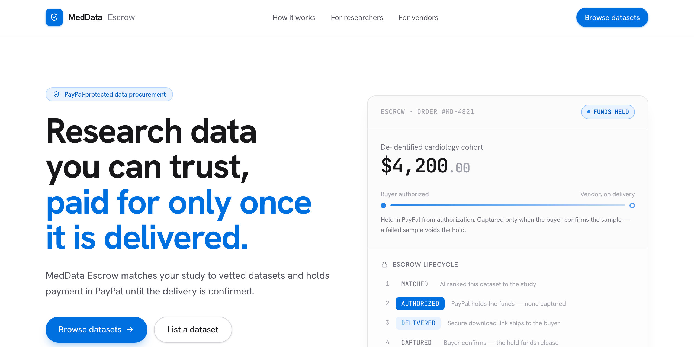
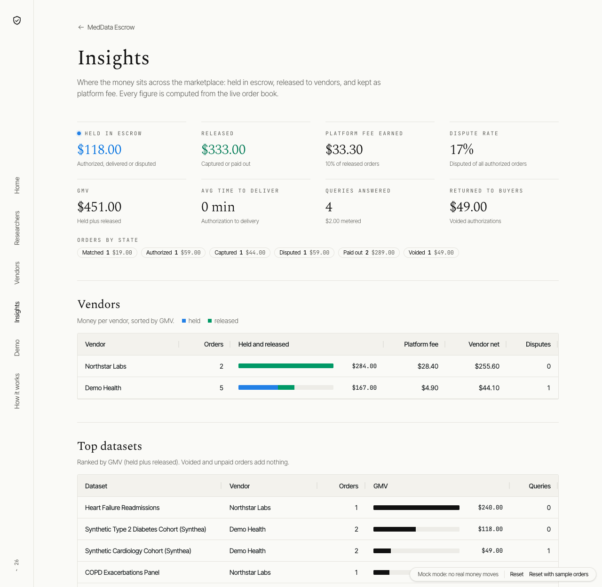
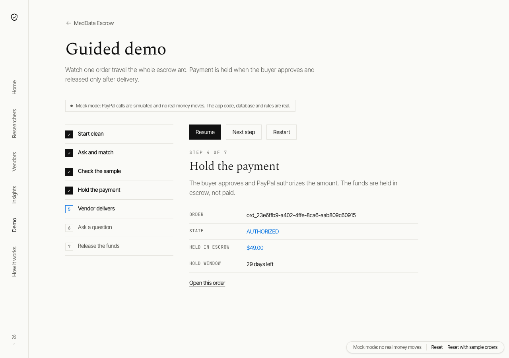
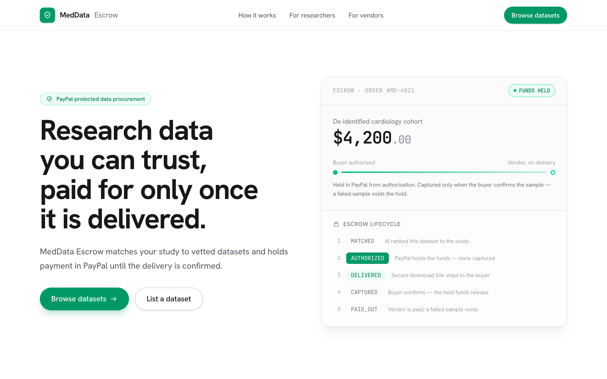
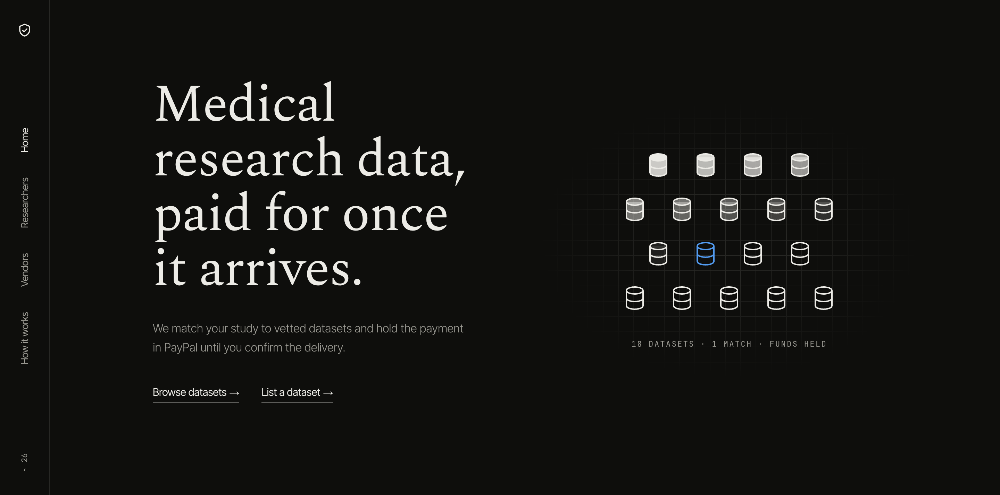
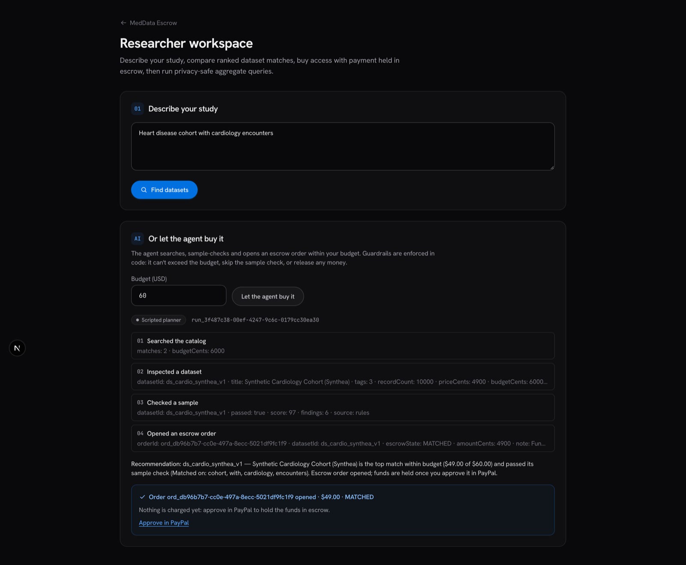
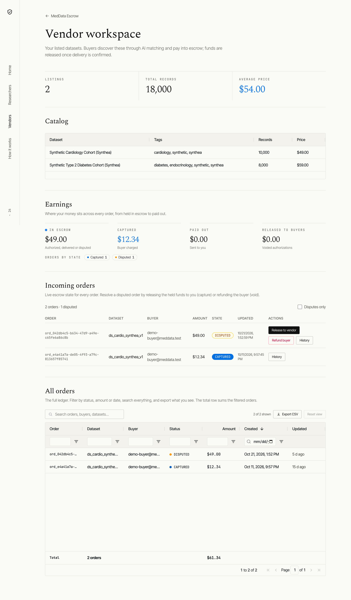

# MedData Escrow

**An AI procurement and escrow marketplace for medical research data. Describe a study in plain English, an AI agent finds a matching dataset and checks a sample, and PayPal holds the money until the data passes. Synthetic (Synthea) data only.**

[](https://github.com/hammy229/meddata-escrow/actions/workflows/ci.yml)
[](LICENSE)

**Links:** [Evals](docs/evals.md) · [Architecture](docs/architecture.md) · [PayPal escrow flow](docs/paypal-flow.md) · [API](docs/api.md) · [Privacy](docs/privacy.md) · [Arham Doshi](https://arhamdoshi.dev) · [LinkedIn](https://linkedin.com/in/arhamdoshi)



MedData Escrow is an AI procurement and escrow marketplace for medical research data. Buyers describe the data they need, Amazon Bedrock (Claude) matches relevant dataset listings, PayPal authorizes and holds payment before access is granted, and the vendor delivers through an expiring download link before payment is captured and settled with the seller. That download link is mocked for now; S3 presigned URLs are the planned version.

**Status:** Actively building for the PayPal AI Hackathon (Devpost deadline: November 12, 2026).

## Results

Each AI and ML piece has a number you can reproduce with `npm run eval`, no keys
needed, and CI fails if a number moves without being committed. Everything is on
SYNTHETIC data, and Claude itself has not been evaluated because Bedrock access is
not on yet. Full tables and limits are in [`docs/evals.md`](docs/evals.md).

| What                                             | Result                                                      |
| ------------------------------------------------ | ----------------------------------------------------------- |
| Money held on clean data with a truthful listing | 0 of 200 at each cohort size, upper bound 2%                |
| Retrieval on a held-out golden set               | MRR 0.846, up from 0.664 for the word overlap baseline      |
| Hostile model red team                           | 26 of 26 blocked, after fixing the 2 that first got through |
| A planted leak on the shipped flawed listing     | Lifts a from-scratch model from AUC 0.69 to 0.81            |

The evals have already found real problems: an imbalance check firing on 97% of
small clean cohorts, an agent willing to buy a COPD dataset for an Alzheimer's study,
one model reply running 300 tool calls, and a hidden group recoverable by subtraction.

### Audits and survival

Added Nov 4 and 5. It runs in mock mode with no keys, and you can watch it at `/demo`.

- **Fitness audit** (`lib/fitness`). Screens a dataset for missing data, too few
  events, repeated subjects, outcome leaks, unbalanced arms and broken listing claims.
  It runs on the sample before purchase and on the data at delivery. It is a screen,
  not proof.
- **Money follows the claims.** Delivered data that breaks a listing's claim moves the
  order to `DISPUTED` and holds the payment for a person to decide. Nothing else holds
  money: not a leak, weak power or drift. A dispute always waits for a person, so a
  silent vendor is not voided automatically.
- **Leak lift and drift.** A flagged column gets a model trained with and without it,
  and the delivery is compared with the sample the buyer checked, using PSI with a
  noise floor. Both are evidence only.
- **Survival as a paid query** (`POST /api/query` with `analysis`). Kaplan-Meier curves
  and log-rank tests, raw and within age bands, on a coarse grid with no filters and no
  exact event times. The flawed cohort shows a gap between arms (p below 0.001) that
  goes away within age bands (p 0.886).

Audits only run on the seeded SYNTHETIC listings. Other listings show as not applicable.

## Why it matters

Medical-school researchers waste weeks sourcing data: they can't inspect quality before paying, vendors can't trust buyers, and sharing raw records creates serious privacy risk. **meddata-escrow** is for **academic medical researchers** (and the data vendors who serve them). It makes buying research data trustworthy on both sides:

- Buyers never pay for data that fails a quality/privacy check.
- Vendors never release raw records. Only privacy-safe aggregates leave their systems.
- Everything is metered, so researchers pay for exactly what they use.

> ⚕️ **All data is synthetic**, generated with [Synthea](https://github.com/synthetichealth/synthea). **No real patient data** is used anywhere.

### Prize map

Where each judging area and prize is addressed. "Mock" means it runs end to end
locally without credentials; see the status line above for what is not yet live.

| Prize or criterion           | Where to look                                                                                                                                                                                         |
| ---------------------------- | ----------------------------------------------------------------------------------------------------------------------------------------------------------------------------------------------------- |
| Best Use of Agentic Commerce | Procurement agent with code-enforced spending mandates (`lib/agent`), and an MCP server so outside agents can buy through PayPal escrow (`docs/mcp.md`)                                               |
| Best Use of PayPal + AI      | Authorize-then-capture escrow, Payouts, verified webhooks, partial capture to settle split disputes, with Claude for matching, sample checks and an advisory dispute arbiter (`lib/escrow`, `lib/ai`) |
| Most Impactful               | Cuts weeks of data sourcing for medical researchers; buyers never pay for failed samples, vendors never hand over raw records                                                                         |
| Best Demo Delivery           | `/demo` runs the whole story through the real APIs in one click; script in `docs/demo-script.md`                                                                                                      |
| Most Creative                | Pay-per-query aggregates, trust scores and a signed data use agreement on every order                                                                                                                 |
| Most Creative: research fit  | Payment tied to whether the data holds up: fitness audit, leak lift, survival query. Numbers in `docs/evals.md`, story at `/demo`                                                                     |
| AG Grid                      | Catalog, compare, order queue, ledger, insights and trust tables (`app/components`, `/insights`)                                                                                                      |
| APIMatic                     | OpenAPI 3.1 spec with drift tests (`openapi/openapi.yaml`); SDK generation steps in `docs/api.md`. Not run through APIMatic yet                                                                       |
| Render                       | `render.yaml` Blueprint with Render Postgres, a seeded demo and a health check. A hosted deploy is still pending                                                                                      |

## How it works

**Architecture flow:** Request → Bedrock match → PayPal authorization → mock delivery link → capture → seller payout.

### The 6-step flow

1. **Describe**: A researcher describes their study in plain English.
2. **Match**: An AI agent matches vendor datasets in the catalog and ranks them by fit (`lib/ai/matcher`).
3. **Sample check**: The agent runs an automated quality + privacy check on a sample of the top match.
4. **Escrow (authorize)**: PayPal **authorizes** the purchase amount. Funds are _held, not captured_ (`/api/orders`).
5. **Capture or void**: If the sample check passes, PayPal **captures** the payment; if it fails, the authorization is **voided** and the researcher is never charged.
6. **Query & meter**: After purchase, plain-English queries return **privacy-safe aggregates** (`lib/ai/nl2query` + `lib/ai/privacy-guard`), each **metered per query** against the order's spend cap in our own ledger. Raw records never leave the vendor.

### Agentic commerce, trust and insights

Added Nov 2 for the PayPal AI Hackathon. All of it runs in mock mode with no keys.

- **Spending mandates** (`lib/agent/mandate.ts`, `POST /api/mandates`). A buyer signs
  a policy (total budget, per-order cap, allowed vendors and tags, expiry) with
  HMAC-SHA256. The agent can only open an escrow order the mandate allows, and the
  check is in code, not in the prompt. A tampered or expired token is a `401`. The
  spend ledger is in the database, so it survives a restart and holds across
  concurrent runs and the MCP server.
- **MCP server** (`npm run mcp`, [`docs/mcp.md`](docs/mcp.md)). A dependency-free
  stdio MCP server lets any outside agent (Claude Desktop, for example) search the
  catalog, run a sample check and place a PayPal escrow order. `place_escrow_order`
  needs a valid mandate and a passing sample check from the same session.
- **Trust score** (`lib/trust`, `GET /api/trust`). Each vendor and dataset gets a
  0 to 100 score from sample-check pass rate, dispute rate, dispute outcomes,
  delivery speed and volume, with a plain-English reason per factor. Small samples
  are shrunk toward neutral so a single order never looks perfect.
- **Dispute arbiter** (`lib/ai/arbiter.ts`, `GET /api/orders?id=&arbitrate=1`). On a
  disputed order, Claude (or a rules fallback in mock mode) recommends refund,
  release, split or needs-human from the audit trail and sample evidence. It is
  advisory only: it cannot import the escrow service, and low confidence is forced
  to needs-human in code.
- **Data use agreement** (`lib/escrow/dua.ts`). Every receipt carries a plain-text
  agreement (aggregate-only, no re-identification) with a SHA-256 fingerprint.
- **Insights** (`/insights`, `GET /api/insights`). Money held vs released, platform
  fee, dispute rate, time to deliver, and AG Grid tables for vendors and datasets.
- **Guided demo** (`/demo`). A seven-step narrated run through the real APIs in mock
  mode: ask, match, sample check, hold, deliver, query, release.

| Insights                                        | Guided demo                                                |
| ----------------------------------------------- | ---------------------------------------------------------- |
|  |  |

### Settling a dispute

The arbiter suggests refund, release or split, and it cannot move money. A split
takes both sides: one offers (`propose_split`), the other accepts with the same
figure (`resolve` + `resolution: split`), and only then does PayPal capture that
part with `final_capture` and release the rest. The order's amount becomes what
was captured, so the fee, payout and receipt all follow it. Nobody can accept
their own offer, or an offer that changed after they read it.

### Escrow deadlines

Nobody can leave money stuck by going quiet. `POST /api/escrow/sweep` (bearer
`ESCROW_SWEEP_SECRET`, meant for a scheduler such as a Render cron job) releases
the payment 7 days after delivery if the buyer has not responded, and refunds the
hold on day 28 if the vendor never delivered. Disputes are never moved, only
flagged for a person. The render.yaml Blueprint sets the secret but not the
schedule, so add a cron job when you deploy. `GET /api/orders?id=` returns the
order's `deadline`, and both workspaces show it.

### Architecture

See [`docs/architecture.md`](docs/architecture.md) for the full design and the escrow-flow Mermaid diagram.

```
Researcher UI ─▶ /api/match   ─▶ lib/ai/matcher          (rank vendor datasets)
                              └▶ lib/ai/sample-check      (pre-purchase sample check)
             ─▶ /api/agent   ─▶ lib/agent/run            (tool loop → escrow order, guardrailed)
             ─▶ /api/orders  ─▶ lib/escrow/service       (state machine + lib/paypal/client)
             ─▶ /api/query   ─▶ lib/ai/nl2query          (NL → plan → safe SQL)
                              └▶ lib/ai/privacy-guard     (screen question, SQL + results)
             ─▶ /api/billing ─▶ lib/db/usage             (per-query metering, query cap)
PayPal       ─▶ /api/webhooks/paypal ─▶ lib/escrow/paypal-webhooks (verified, deduped)
Escrow       ─▶ lib/events/outbound  (signed webhook per transition → Zapier)
Vendor UI    ─▶ manage catalog (data/catalog.json → DB via lib/db)
Data layer   ─▶ lib/db/schema.sql  (SQLite via node:sqlite; portable SQL)
             ─▶ order_events        (append-only audit trail, one row per transition)
             ─▶ agent_runs          (every agent step, replayable)
```

Every escrow transition is recorded in an append-only `order_events` trail,
written inside `createOrder`/`advanceOrder` so the history can never drift from
an order's status. Read a single order's timeline (oldest-first) with
`GET /api/orders?id=<orderId>&events=1`. A `dispute` or `resolve` PATCH can
include a `note` (e.g. the dispute reason), recorded on that transition's event.

#### Trust guarantees

The server, not the client, decides who pays what and who sees what:

- **Price is server-set.** `POST /api/orders` escrows the dataset's listed
  price. An optional `amount` is only a confirmation, and a mismatch is `422`,
  so a tampered request can't escrow $0.01 for a $49 dataset.
- **No query without a paid, delivered order.** `POST /api/query` requires an
  `orderId` for that dataset in `DELIVERED`, `CAPTURED` or `PAID_OUT`
  (`grantsDataAccess`). Access freezes while a dispute is open.
- **Two privacy screens.** The plain-English question is screened for
  identifiers and row-level asks (`checkQuestion`), then the compiled SQL is
  re-checked as aggregate-only (`checkQuery`), and results go through small-cell
  suppression (k ≥ 11, `checkResult`).
- **Metered per answer, capped per order.** Each answered query is metered
  against the order at a fixed server fee (`PER_QUERY_FEE_CENTS`, 50 cents) in
  our own ledger. Nothing is billed through PayPal per query. Each order has a
  spend cap (`queryCapCents`, $10.00 by default, between $0.50 and $1,000.00).
  Once one more query would pass the cap, the API answers `402` and meters
  nothing. Rejected or suppressed queries are never metered.
- **Honor window.** While PayPal holds the funds, the order shows its
  authorization window: honored for 3 days, valid for up to 29, with the days
  left (`lib/escrow/auth-window.ts`). Past day 29 the hold has to be
  reauthorized.
- **Receipts add up.** `GET /api/orders?id=<id>&receipt=1` splits the amount
  into the platform fee and the vendor payout, which always sum to the price.
  The total adds per-query charges, and the receipt shows the order's query
  cap. A voided or cancelled order shows zeros.

#### AI & the procurement agent

Claude on Amazon Bedrock is opt-in (`LLM_PROVIDER=bedrock`, client in
`lib/llm/client.ts`). Every AI step has a deterministic fallback, so the full
app (including the agent) runs with no AWS access.

- **Matching**: Claude ranks catalog datasets for a study; BM25 with a small
  medical synonym map is the fallback (`lib/ai/matcher`). A weak offline match is
  flagged and the agent will not buy on it.
- **Tracing and timeouts**: every model call records operation, prompt hash,
  latency, tokens and outcome, never prompts or data (`lib/llm/trace.ts`). A hung
  call stops after `LLM_TIMEOUT_MS` and falls back.
- **Questions → plans, never SQL**: Claude emits a typed query plan that
  `compilePlan` turns into SQL; the model never writes SQL itself.
- **Privacy second opinion**: Claude can only _tighten_ the rule-based privacy
  verdict, never loosen it.
- **Sample check**: a quality check on a dataset sample before money moves
  (`lib/ai/sample-check.ts`, `POST /api/match { sampleCheck }`).
- **Safe rewrites and summaries**: a refused question comes back with a
  rephrasing that goes through the same privacy screen before it is offered
  (`suggestRewrite`). Each answer gets a one-sentence summary
  (`lib/ai/answer-summary.ts`); if Claude's wording adds a number the rows do
  not contain, the rule-based sentence is used instead.

**Procurement agent** (`lib/agent`, `POST /api/agent`): give it a study and a
budget and it searches, inspects, sample-checks and opens an escrow order using
four tools: `search_datasets`, `get_dataset`, `check_sample`,
`create_escrow_order`. The guardrails live in code, not the prompt: an order is
refused unless the dataset exists, its listed price fits the budget, a
_passing_ sample check ran in the same run, the buyer does not already own the
dataset, and no order was placed yet. Sample checks are capped at three per run.
When a sample fails, the agent moves on to the next in-budget candidate, and
search results flag datasets the buyer already owns (`alreadyOwned`). The agent
can only open a `MATCHED` order; it has no tool to authorize, capture or pay
out. The human buyer still approves in PayPal. Runs are capped at 8 model
turns, fall back to a scripted planner when the LLM is off, and every step is
stored in `agent_runs` (`GET /api/agent?runId=`). Each run also returns a
`shortlist` of the candidates it looked at, best first, with a short reason
for each. `/agent/<runId>` shows the same run as a shareable replay page, with
each guardrail marked as enforced or triggered.

#### Escrow in the workspaces

- **Checkout round trip.** Buy (escrow) saves the study text, opens (or reuses)
  the `MATCHED` order, and sends the buyer to its approval page: `/checkout/mock`
  in mock mode, PayPal's own page otherwise. Approving or cancelling there leads
  back to `/researcher?orderId=<id>`. The workspace reopens the order from that
  link and reads its state from the API. A real PayPal return (with a `token`,
  or `cancelled=1`) authorizes or cancels the order if it is still `MATCHED`.
- **Live sync and hold chip.** While an order can still change, the workspace
  polls `GET /api/orders?id=` every 4 seconds, so a vendor's delivery, a dispute
  or a void shows up without a reload. Polling stops at `PAID_OUT`, `VOIDED` and
  `CANCELLED`. While PayPal holds the funds, a chip shows the hold's days left,
  such as "Funds held · 2 days left · honor period ended …".
- **Expiring download link.** Once the vendor delivers, the workspace shows a
  "Download dataset (link expires HH:MM)" link. Each read mints a new link that
  lives for 900 seconds. For now it is a mock link on `mock-delivery.meddata.local`,
  so it does not download a real file.
- **Query cap.** Each order has a spend cap, $10.00 by default. A query that would
  go past it gets `402`. After a `402`, the spend line reads "$10.00 of $10.00
  used" with a note that the order cannot run more queries.
- **Vendor catalog.** An AG Grid with column groups (Listing and Performance). The
  performance columns show orders, money in escrow, net earned after the fee and
  the last order. Click a price to edit it, then press Ctrl+Z to undo up to the
  last 10 edits.
- **Order queue.** Incoming orders sit in an AG Grid with a "Needs action" filter.
  An authorized order gets **Deliver data**. A disputed order gets **Release to
  vendor** (capture) or **Refund buyer** (void), each with an optional resolution
  note. Each row opens its audit history underneath.
- **Ledger.** Each row splits the amount into the platform fee and the vendor's
  net. A pinned total row sums both, so the amount equals the fee plus the net on
  every row and in the total.
- **Webhook replay.** In mock mode the webhook simulator sends a buyer approval
  (authorization created), a capture, a refund, a void or a dispute. **Replay
  last event** sends the same event id again. The server answers that it is a
  duplicate, so nothing changes.
- **Demo catalog.** Six synthetic datasets. Two are built to fail their sample
  check: the Pediatric Asthma Pilot (640 records, under the 1,000 minimum) and
  the COPD Exacerbations Panel (3.4% duplicate rows, over the 2% limit). The
  Heart Failure Readmissions dataset lists at $240, above a $60 demo budget.
- **Mock-mode bar.** In mock mode a bar at the bottom right says that no real
  money moves. **Reset** clears the demo data. **Reset with sample orders** also
  adds six orders in different states, including a hold with 2 days left.

#### API reference

| Method & path                                                            | Purpose                                                                                                                                                                                  |
| ------------------------------------------------------------------------ | ---------------------------------------------------------------------------------------------------------------------------------------------------------------------------------------- |
| `POST /api/match` `{ description }`                                      | Rank catalog datasets for a study description (each match carries `priceCents` and `recordCount`)                                                                                        |
| `GET /api/datasets`                                                      | Catalog with the database prices (what orders charge), record counts and tags                                                                                                            |
| `PATCH /api/datasets` `{ datasetId, priceCents }`                        | Reprice a listing: whole cents, $1.00 to $10,000.00 (`422` otherwise)                                                                                                                    |
| `POST /api/match` `{ sampleCheck, description? }`                        | Pre-purchase sample quality check on one dataset                                                                                                                                         |
| `POST /api/orders` `{ datasetId, amount?, buyerEmail?, queryCapCents? }` | Create an escrow order at the listed price (`MATCHED`); `200` with `reused: true` if a matching unapproved order exists. `queryCapCents` is 50 to 100000 (default 1000), `422` otherwise |
| `PATCH /api/orders` `{ orderId, action, resolution?, note? }`            | Advance escrow: `authorize · deliver · capture · payout · void · dispute · cancel · resolve`                                                                                             |
| `GET /api/orders` `?status= &datasetId= &buyerEmail=`                    | List orders (newest first)                                                                                                                                                               |
| `GET /api/orders?id=<id>[&events=1]`                                     | One order with its `authorization` window (while funds are held), a `delivery` link (once data is granted, minted per read) and optional audit timeline                                  |
| `GET /api/orders?id=<id>&receipt=1`                                      | Receipt: amount, platform fee, vendor payout, query charges, query cap, total                                                                                                            |
| `GET /api/orders?summary=1[&datasetId=]`                                 | Vendor earnings: counts by status, held / captured / paid-out (gross) / released cents, plus vendor net and platform fee on paid-out orders                                              |
| `POST /api/query` `{ orderId, datasetId, analysis }`                     | Kaplan-Meier survival on a SYNTHETIC listing, `analysis` is `{ type: "survival", groupBy }`, metered like an answer                                                                      |
| `POST /api/match` `{ fitnessCheck, description? }`                       | Fitness audit on the sample of a SYNTHETIC listing, or `null` if it has no rows to screen                                                                                                |
| `GET /api/orders?id=&audit=1`                                            | The order's stored delivery audit, or `null` if the listing was not audited                                                                                                              |
| `POST /api/query` `{ orderId, datasetId, question }`                     | Plain-English question → privacy-safe aggregate with a one-sentence `summary`, metered (`usage` in response); a `403` may carry a safe `suggestion`; `402` once the query cap is reached |
| `GET /api/billing?orderId=<id>`                                          | An order's per-query usage, `queryCount`, `totalCents`                                                                                                                                   |
| `POST /api/billing` `{ orderId, question }`                              | Record one query charge (fee is server-set; `409` without data access; `402` at the cap)                                                                                                 |
| `POST /api/agent` `{ study, budgetCents }`                               | Run the procurement agent; returns `runId`, steps, recommendation, `shortlist`, order                                                                                                    |
| `GET /api/agent?runId=<id>`                                              | Replay a stored agent run (audit), with its `shortlist`                                                                                                                                  |
| `GET /api/mandates`, `DELETE /api/mandates?mandateId=`                   | List your mandates with spent and remaining, or revoke one so the agent and MCP server stop buying under it right away                                                                   |
| `POST /api/escrow/sweep`                                                 | For a scheduler, with a bearer secret: acts on escrow deadlines. Returns `released`, `refunded`, `needsReview`, `blocked` and `failed`                                                   |
| `POST /api/mandates` `{ maxTotalCents, maxPerOrderCents?, ... }`         | Issue a signed spending mandate; pass the `token` to `POST /api/agent` as `mandate` (`401` if bad or expired)                                                                            |
| `GET /api/trust` `?vendorId= or ?datasetId=`                             | Trust score, grade and per-factor reasons (no query lists everything)                                                                                                                    |
| `GET /api/orders?id=<id>&arbitrate=1`                                    | Advisory dispute recommendation (`409` unless the order is `DISPUTED`)                                                                                                                   |
| `GET /api/insights`                                                      | Marketplace figures: held vs released money, fees, dispute rate, vendors, datasets                                                                                                       |
| `POST /api/webhooks/paypal`                                              | Signature-verified, deduped PayPal events applied to escrow state, matched by PayPal ids or our order id                                                                                 |
| `POST /api/demo/reset`                                                   | Mock mode only: clears orders, events, usage and agent runs, then reseeds the catalog. Body `{ "seed": "story" }` also adds six sample orders (`404` otherwise, `422` for other bodies)  |
| `GET /api/openapi`                                                       | The OpenAPI 3.1 spec (`openapi/openapi.yaml`)                                                                                                                                            |
| `GET /api/health`                                                        | Uptime check: `{ status, mode, db }` (Render health check)                                                                                                                               |

Errors are always `{ error }` (plus `reasons` on privacy rejections).

### Screens

| Landing (light)                                               | Landing (dark)                                              |
| ------------------------------------------------------------- | ----------------------------------------------------------- |
|  |  |

**Procurement agent**: a $60 budget runs search, inspect and sample check, then opens a
`MATCHED` escrow order the buyer approves in PayPal (mock mode, synthetic data).



**Vendor workspace**: listings, where the money sits (held, captured, paid
out), incoming orders with dispute buttons, and the full ledger.



## Tech stack

Next.js and React (AG Grid for tables), Amazon Bedrock (Claude, opt-in), PayPal sandbox APIs, and PostgreSQL for hosted persistence (SQLite through Node's `node:sqlite` for local development), deployed on Render. Planned, not used yet: Amazon S3 presigned delivery, DynamoDB, and AWS Lambda with API Gateway.

### Tools used and how

| Tool                                      | How it's used                                                                                                                                                                      |
| ----------------------------------------- | ---------------------------------------------------------------------------------------------------------------------------------------------------------------------------------- |
| **PayPal** (Orders/Payments API, sandbox) | Escrow via authorize-then-capture (`lib/paypal/client.ts`, `app/api/orders`). Per-query charges are metered in our own ledger (`app/api/billing`), not billed through PayPal       |
| **PayPal** (Payouts + Webhooks)           | Vendor payouts minus a 10% fee (`lib/escrow/fees.ts`); verified, deduped webhooks at `/api/webhooks/paypal`; `PayPal-Request-Id` idempotency on every write                        |
| **Claude on Amazon Bedrock**              | Dataset ranking, question → query plan, tighten-only privacy review, sample check, and the procurement agent (`lib/llm`, `lib/ai`, `lib/agent`); opt-in via `LLM_PROVIDER=bedrock` |
| **OpenAPI 3.1**                           | Contract for every route (`openapi/openapi.yaml`, served at `/api/openapi`) with drift tests; Postman collection generated from it                                                 |
| **Zapier** (outbound webhooks)            | Every escrow transition POSTs a signed event to `OUTBOUND_WEBHOOK_URL` (`lib/events/outbound.ts`)                                                                                  |
| **AG Grid**                               | Dataset catalog, vendor order queue, ledger and query-result tables in the researcher and vendor workspaces                                                                        |
| **Render**                                | One-click Blueprint deploy via [`render.yaml`](./render.yaml): Render PostgreSQL app database, `/api/health` check                                                                 |
| **Postman**                               | API collection to exercise and demo every endpoint ([`postman/`](./postman))                                                                                                       |

## Getting started

```bash
# 1. Clone
git clone https://github.com/hammy229/meddata-escrow.git
cd meddata-escrow

# 2. Install
npm install

# 3. Configure environment
cp .env.example .env.local        # then fill in the values (see table below)

# 4. Seed the local database
npm run seed

# 5. Run the dev server
npm run dev                       # http://localhost:3000
```

Production build: `npm run build && npm start`.

For hosted app persistence and live provider sources, see
[Live databases](docs/live-databases.md). The Render blueprint creates the app
PostgreSQL database and supplies its URL automatically. Optional local servers
for both paths are in `compose.yaml`. Run `npm run db:configure` once to generate
the provider credential encryption key, then `npm run db:migrate` and
`npm run db:check` after setting `APP_DATABASE_URL`.

#### Environment variables

| Variable                    | Required | Description                                                                                 |
| --------------------------- | :------: | ------------------------------------------------------------------------------------------- |
| `PAYPAL_MODE`               |    no    | `mock` runs the whole escrow arc with no PayPal keys; unset = real sandbox calls            |
| `PAYPAL_CLIENT_ID`          | sandbox  | PayPal **sandbox** app client ID                                                            |
| `PAYPAL_CLIENT_SECRET`      | sandbox  | PayPal **sandbox** app secret                                                               |
| `PAYPAL_API_BASE`           |    no    | PayPal API base (default `https://api-m.sandbox.paypal.com`)                                |
| `PAYPAL_WEBHOOK_ID`         | webhooks | Webhook id used to verify inbound PayPal webhooks                                           |
| `LLM_PROVIDER`              |    no    | `bedrock` enables Claude on Amazon Bedrock; unset = deterministic fallbacks                 |
| `AWS_REGION`                | Bedrock  | Bedrock region (default `us-east-1`); credentials from the AWS chain                        |
| `LLM_MODEL`                 |    no    | Bedrock model id override (default `anthropic.claude-opus-5-5`)                             |
| `APP_DATABASE_URL`          |  hosted  | PostgreSQL URL; supplied automatically by the Render blueprint                              |
| `CONNECTION_ENCRYPTION_KEY` | sources  | 32-byte base64 key; `npm run db:configure` locally, generated on Render                     |
| `PROVIDER_DATABASE_HOSTS`   | sources  | Exact comma-separated approved source hostnames                                             |
| `DATABASE_URL`              |    ✅    | SQLite local fallback (`file:./data/dev.sqlite`); hosted PostgreSQL uses `APP_DATABASE_URL` |
| `OUTBOUND_WEBHOOK_URL`      |    no    | Receives signed escrow events (e.g. a Zapier Catch Hook)                                    |
| `OUTBOUND_WEBHOOK_SECRET`   |    no    | HMAC secret for `X-MedData-Signature` on outbound events                                    |
| `NEXT_PUBLIC_SITE_URL`      |    no    | Absolute site URL for share metadata                                                        |

> 🔒 Never commit secrets. Only `.env.example` (with empty placeholders) is tracked.

#### PayPal sandbox setup

1. Sign in at the [PayPal Developer Dashboard](https://developer.paypal.com/dashboard/).
2. Go to **Apps & Credentials → Sandbox** and **Create App**.
3. Copy the **Client ID** and **Secret** into `.env.local` (`PAYPAL_CLIENT_ID`, `PAYPAL_CLIENT_SECRET`) and remove `PAYPAL_MODE=mock`.
4. Keep `PAYPAL_API_BASE=https://api-m.sandbox.paypal.com`.
5. Use the dashboard's **Sandbox → Accounts** to get a test buyer login for the demo.
6. Run `npm run demo -- --sandbox`. It creates a real sandbox escrow order and prints the approve link. After the test buyer approves it, run `npm run demo -- --sandbox --resume <orderId>` to authorize, deliver, capture and pay out. Set `SANDBOX_PAYOUT_EMAIL` to a sandbox account to receive the payout.

### Accounts and setup

Open `/signup` to create a researcher or data-provider account, then complete
`/setup`. Researchers save their institution and research focus; providers save
organization and PayPal payout details. Sessions persist in SQLite, and each
account sees only its own orders and research runs. Provider listings and
pricing are scoped to their organization. New providers start with an empty
catalog; connect a PostgreSQL research view and publish synthetic cohorts in the provider workspace.

See [account setup and deployment notes](docs/accounts.md). Email verification,
password recovery, and MFA remain launch prerequisites. The global demo reset
endpoint is disabled. Existing CLI/Postman demo sequences require authenticated
sessions and the appropriate researcher/provider identity for each action.

### Demo

- 🌐 **Hosted demo:** _placeholder, link coming soon_
- 🎥 **Demo video (YouTube, < 3 min):** _placeholder, link coming soon_

#### Run it locally

```bash
npm test               # unit tests (node:test + tsx): escrow state machine, SQLite
                       # persistence, PayPal client, matcher, nl2query, privacy guard, routes
                       # (511 passing as of November 1, 2026)
npm run demo           # happy-path CLI: match → authorize → deliver → capture → payout
npm run dev:mock       # full UI + API, no PayPal keys needed (http://localhost:3000)
npm run demo -- --sandbox "heart disease cohort"   # real sandbox calls (.env.local)
```

**Try the full flow in the browser (no credentials):** `npm run dev:mock`, then
open [`/researcher`](http://localhost:3000/researcher). Describe a study, tick up
to three matches to compare them, and pick one. **Buy (escrow)** opens the local
checkout page at `/checkout/mock`, which stands in for PayPal's approval page.
Approve there, then **Back to the workspace** returns you to
`/researcher?orderId=…`, where the order is reloaded from the server. Run a
privacy-safe query, read the receipt card, and use **Confirm & release payment**
and **Pay out vendor**. The vendor delivers the data on
[`/vendor`](http://localhost:3000/vendor) with **Deliver data**. Cancel is
available until the order is approved. A refused question offers a **Try
instead** rewrite. The vendor page also has the catalog (edit a price inline and
the next order charges it; Ctrl+Z undoes the edit), the order queue, the ledger
with fee and net, the order drawer and a PayPal webhook simulator. To start over
between takes, use **Reset** or **Reset with sample orders** in the mock-mode bar
(or call `POST /api/demo/reset` in mock mode).

The escrow lifecycle is a pure state machine in `lib/escrow/state-machine.ts`
(`MATCHED → AUTHORIZED → DELIVERED → CAPTURED → PAID_OUT`, with
`DISPUTED → VOIDED | CAPTURED`); order state persists via SQLite
(`lib/db`, built on Node's `node:sqlite`). Everything is **mock-first**: both the
CLI (`npm run demo`) and the app (`PAYPAL_MODE=mock`) drive the real state machine,
matcher, and privacy guard against stubbed PayPal + delivery, so no AWS and no
credentials are needed. The real sandbox path drops in behind the same interfaces.
See [TODO-paypal-tools.md](./TODO-paypal-tools.md) for the sponsor-tool
verification pass (PayPal AI-Toolkit + PayPal MCP).

## Project structure

```
meddata-escrow/
├─ app/
│  ├─ researcher/            # researcher workspace (browse, compare, query, buy)
│  ├─ vendor/                # vendor workspace (catalog, ledger, order drawer, webhook simulator)
│  ├─ agent/[runId]/         # shareable replay of one procurement agent run
│  ├─ checkout/mock/         # local stand-in for PayPal's approval page (mock mode)
│  └─ api/
│     ├─ match/              # POST: match datasets to a study description
│     ├─ datasets/           # GET/PATCH: catalog with database prices; reprice a listing
│     ├─ orders/             # GET/POST/PATCH: list + escrow lifecycle (authorize → capture/void/payout, dispute/resolve, cancel); GET ?events= returns the audit timeline, ?receipt=1 the fee receipt
│     ├─ query/              # POST: plain-English query (paid order required; privacy-safe aggregate, metered, one-sentence summary)
│     ├─ billing/            # GET/POST: per-query usage and spend
│     ├─ agent/              # POST/GET: procurement agent runs (with shortlist)
│     ├─ demo/reset/         # POST: mock mode only, resets the demo data (optionally with sample orders)
│     └─ health/             # GET: uptime check
├─ lib/
│  ├─ ai/                    # matcher, nl2query, privacy-guard (incl. safe rewrites), answer-summary
│  ├─ agent/                 # procurement tool loop, run store, shortlist, replay
│  ├─ query/                 # mock vendor-side executor, per-query pricing, query suggestions
│  ├─ escrow/                # escrow state machine, data-access rule, authorization window, receipts, mock webhook events
│  ├─ catalog/               # listing price rules (whole cents, $1 to $10,000)
│  ├─ ui/                    # pure helpers for the grids and workspaces: compare, bar scale, status filter, escrow messages, order sync, ledger, listing stats, vendor actions
│  ├─ paypal/                # PayPal Orders/Payments client
│  └─ db/                    # SQLite persistence layer (client.ts, usage.ts, datasets.ts, reset.ts, demo-story.ts), schema.sql, seed.ts
├─ data/catalog.json         # dataset catalog (synthetic)
├─ scripts/                  # generate-data.sh (Synthea), seed.sh
├─ docs/                     # architecture, paypal-flow, privacy, demo-script, checklist
├─ postman/                  # API collection
├─ render.yaml               # Render deploy config
└─ .github/                  # CI workflow + PR/issue templates
```

## Testing

```bash
npm test          # unit and integration tests
npm run eval      # reproduces every number in Results, no keys needed
```

CI runs lint, the type check, the tests, the audit eval, and the production build on every push. It fails if the audit eval's committed results change without being committed again.

## Limitations and next steps

- All data is synthetic, generated with Synthea. No real patient data is used anywhere.
- The vendor download link is mocked. S3 presigned URLs are the planned version.
- Claude itself has not been evaluated, because Bedrock access is not on yet. The evals cover everything around it.
- Email verification, password recovery, and MFA are still needed before a real launch.
- Planned, not used yet: Amazon S3 presigned delivery, DynamoDB, and AWS Lambda with API Gateway.

### Contributing and security

See [CONTRIBUTING.md](./CONTRIBUTING.md) and [SECURITY.md](./SECURITY.md).

## License

MIT, see [LICENSE](LICENSE). Built by [Arham Doshi](https://arhamdoshi.dev).
