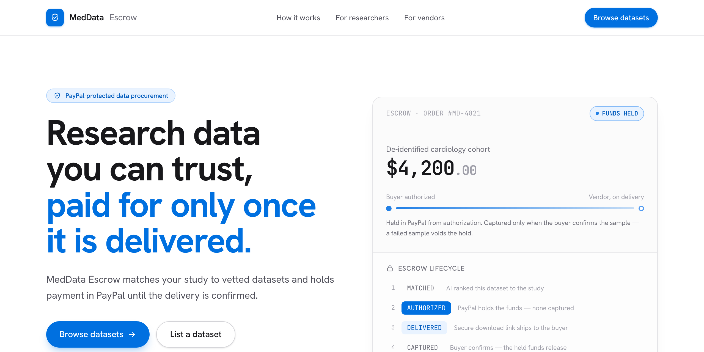
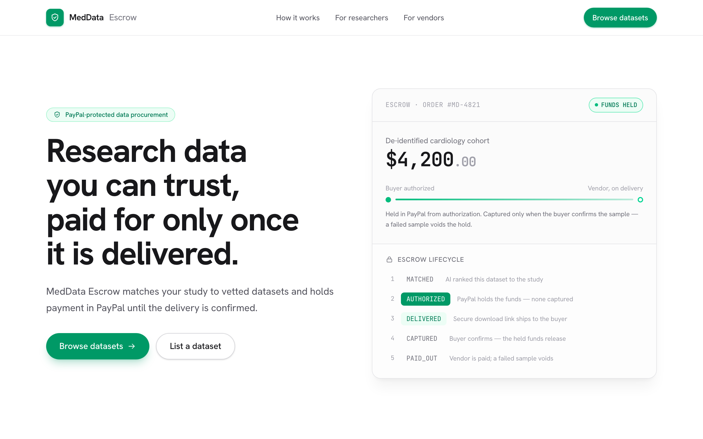
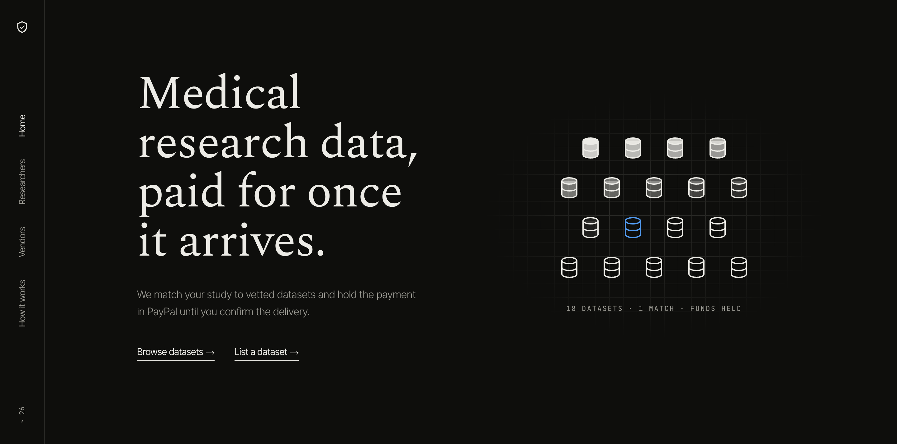

# meddata-escrow

[](./LICENSE)
[](https://github.com/hammy229/meddata-escrow/actions/workflows/ci.yml)



## In Progress: MedData Escrow

MedData Escrow is an AI procurement and escrow marketplace for medical research data. Buyers describe the data they need, Amazon Bedrock (Claude) matches relevant dataset listings, PayPal authorizes and holds payment before access is granted, and data is delivered through time-limited Amazon S3 presigned URLs before payment is captured and settled with the seller.

**Tech stack:** Amazon Bedrock (Claude), Amazon S3, DynamoDB, AWS Lambda + API Gateway, and PayPal sandbox APIs.

**Status:** Actively building for the PayPal AI Hackathon (Devpost deadline: November 12, 2026).

**Architecture flow:** Request → Bedrock match → PayPal authorization → S3 delivery → capture → seller payout.

> **An AI procurement + escrow marketplace for medical research data.** Describe your study in plain English; an AI agent finds the right dataset, verifies a sample, and buys it via PayPal escrow — funds captured only if the sample passes.

## Problem & who it's for

Medical-school researchers waste weeks sourcing data: they can't inspect quality before paying, vendors can't trust buyers, and sharing raw records creates serious privacy risk. **meddata-escrow** is for **academic medical researchers** (and the data vendors who serve them). It makes buying research data trustworthy on both sides:

- Buyers never pay for data that fails a quality/privacy check.
- Vendors never release raw records — only privacy-safe aggregates leave their systems.
- Everything is metered, so researchers pay for exactly what they use.

> ⚕️ **All data is synthetic**, generated with [Synthea](https://github.com/synthetichealth/synthea). **No real patient data** is used anywhere.

## Screens

| Landing (light)                                               | Landing (dark)                                              |
| ------------------------------------------------------------- | ----------------------------------------------------------- |
|  |  |


## How it works (6-step flow)

1. **Describe** — A researcher describes their study in plain English.
2. **Match** — An AI agent matches vendor datasets in the catalog and ranks them by fit (`lib/ai/matcher`).
3. **Sample check** — The agent runs an automated quality + privacy check on a sample of the top match.
4. **Escrow (authorize)** — PayPal **authorizes** the purchase amount — funds are _held, not captured_ (`/api/orders`).
5. **Capture or void** — If the sample check passes, PayPal **captures** the payment; if it fails, the authorization is **voided** and the researcher is never charged.
6. **Query & bill** — After purchase, plain-English queries return **privacy-safe aggregates** (`lib/ai/nl2query` + `lib/ai/privacy-guard`), each **billed per query** via PayPal. Raw records never leave the vendor.

## Tools used & how

| Tool                                      | How it's used                                                                                                                                                                      |
| ----------------------------------------- | ---------------------------------------------------------------------------------------------------------------------------------------------------------------------------------- |
| **PayPal** (Orders/Payments API, sandbox) | Escrow via authorize-then-capture; per-query billing (`lib/paypal/client.ts`, `app/api/orders`, `app/api/billing`)                                                                 |
| **PayPal** (Payouts + Webhooks)           | Vendor payouts minus a 10% fee (`lib/escrow/fees.ts`); verified, deduped webhooks at `/api/webhooks/paypal`; `PayPal-Request-Id` idempotency on every write                        |
| **Claude on Amazon Bedrock**              | Dataset ranking, question → query plan, tighten-only privacy review, sample check, and the procurement agent (`lib/llm`, `lib/ai`, `lib/agent`); opt-in via `LLM_PROVIDER=bedrock` |
| **OpenAPI 3.1**                           | Contract for every route (`openapi/openapi.yaml`, served at `/api/openapi`) with drift tests; Postman collection generated from it                                                 |
| **Zapier** (outbound webhooks)            | Every escrow transition POSTs a signed event to `OUTBOUND_WEBHOOK_URL` (`lib/events/outbound.ts`)                                                                                  |
| **AG Grid**                               | Interactive dataset catalog and query-result tables in the researcher/vendor UIs                                                                                                   |
| **Render**                                | One-click Blueprint deploy via [`render.yaml`](./render.yaml): seeded SQLite demo, `/api/health` check                                                                             |
| **Postman**                               | API collection to exercise and demo every endpoint ([`postman/`](./postman))                                                                                                       |

## Architecture

See [`docs/architecture.md`](docs/architecture.md) for the full design and the escrow-flow Mermaid diagram.

```
Researcher UI ─▶ /api/match   ─▶ lib/ai/matcher          (rank vendor datasets)
                              └▶ lib/ai/sample-check      (pre-purchase sample check)
             ─▶ /api/agent   ─▶ lib/agent/run            (tool loop → escrow order, guardrailed)
             ─▶ /api/orders  ─▶ lib/escrow/service       (state machine + lib/paypal/client)
             ─▶ /api/query   ─▶ lib/ai/nl2query          (NL → plan → safe SQL)
                              └▶ lib/ai/privacy-guard     (screen question, SQL + results)
             ─▶ /api/billing ─▶ lib/db/usage             (per-query charge)
PayPal       ─▶ /api/webhooks/paypal ─▶ lib/escrow/paypal-webhooks (verified, deduped)
Escrow       ─▶ lib/events/outbound  (signed webhook per transition → Zapier)
Vendor UI    ─▶ manage catalog (data/catalog.json → DB via lib/db)
Data layer   ─▶ lib/db/schema.sql  (SQLite via node:sqlite; portable SQL)
             ─▶ order_events        (append-only audit trail, one row per transition)
             ─▶ agent_runs          (every agent step, replayable)
```

Every escrow transition is recorded in an append-only `order_events` trail,
written inside `createOrder`/`advanceOrder` so the history can never drift from
an order's status. Read a single order's timeline (oldest-first) with
`GET /api/orders?id=<orderId>&events=1`. A `dispute` or `resolve` PATCH can
include a `note` (e.g. the dispute reason), recorded on that transition's event.

### Trust guarantees

The server, not the client, decides who pays what and who sees what:

- **Price is server-set.** `POST /api/orders` escrows the dataset's listed
  price. An optional `amount` is only a confirmation, and a mismatch is `422`,
  so a tampered request can't escrow $0.01 for a $49 dataset.
- **No query without a paid, delivered order.** `POST /api/query` requires an
  `orderId` for that dataset in `DELIVERED`, `CAPTURED` or `PAID_OUT`
  (`grantsDataAccess`). Access freezes while a dispute is open.
- **Two privacy screens.** The plain-English question is screened for
  identifiers and row-level asks (`checkQuestion`), then the compiled SQL is
  re-checked as aggregate-only (`checkQuery`), and results go through small-cell
  suppression (k ≥ 11, `checkResult`).
- **Metered per answer.** Each answered query is billed against the order at a
  fixed server fee (`PER_QUERY_FEE_CENTS`). Rejected or suppressed queries are
  never billed.

### AI & the procurement agent

Claude on Amazon Bedrock is opt-in (`LLM_PROVIDER=bedrock`, client in
`lib/llm/client.ts`). Every AI step has a deterministic fallback, so the full
app — including the agent — runs with no AWS access.

- **Matching** — Claude ranks catalog datasets for a study; keyword scoring is
  the fallback (`lib/ai/matcher`).
- **Questions → plans, never SQL** — Claude emits a typed query plan that
  `compilePlan` turns into SQL; the model never writes SQL itself.
- **Privacy second opinion** — Claude can only _tighten_ the rule-based privacy
  verdict, never loosen it.
- **Sample check** — a quality check on a dataset sample before money moves
  (`lib/ai/sample-check.ts`, `POST /api/match { sampleCheck }`).

**Procurement agent** (`lib/agent`, `POST /api/agent`): give it a study and a
budget and it searches, inspects, sample-checks and opens an escrow order using
four tools — `search_datasets`, `get_dataset`, `check_sample`,
`create_escrow_order`. The guardrails live in code, not the prompt: an order is
refused unless the dataset exists, its listed price fits the budget, a
_passing_ sample check ran in the same run, and no order was placed yet. The
agent can only open a `MATCHED` order; it has no tool to authorize, capture or
pay out — the human buyer still approves in PayPal. Runs are capped at 8 model
turns, fall back to a scripted planner when the LLM is off, and every step is
stored in `agent_runs` (`GET /api/agent?runId=`).

### API reference

| Method & path                                                 | Purpose                                                                             |
| ------------------------------------------------------------- | ----------------------------------------------------------------------------------- |
| `POST /api/match` `{ description }`                           | Rank catalog datasets for a study description                                       |
| `POST /api/orders` `{ datasetId, amount? }`                   | Create an escrow order at the listed price (`MATCHED`)                              |
| `PATCH /api/orders` `{ orderId, action, resolution?, note? }` | Advance escrow: `authorize · deliver · capture · payout · void · dispute · resolve` |
| `GET /api/orders` `?status= &datasetId= &buyerEmail=`         | List orders (newest first)                                                          |
| `GET /api/orders?id=<id>&events=1`                            | One order plus its audit timeline                                                   |
| `GET /api/orders?summary=1[&datasetId=]`                      | Vendor earnings: counts by status, held / captured / paid-out / released cents      |
| `POST /api/query` `{ orderId, datasetId, question }`          | Plain-English question → privacy-safe aggregate, metered (`usage` in response)      |
| `GET /api/billing?orderId=<id>`                               | An order's per-query usage, `queryCount`, `totalCents`                              |
| `POST /api/billing` `{ orderId, question }`                   | Record one query charge (fee is server-set; `409` without data access)              |
| `POST /api/match` `{ sampleCheck, description? }`             | Pre-purchase sample quality check on one dataset                                    |
| `POST /api/agent` `{ study, budgetCents }`                    | Run the procurement agent; returns `runId`, steps, recommendation, order            |
| `GET /api/agent?runId=<id>`                                   | Replay a stored agent run (audit)                                                   |
| `POST /api/webhooks/paypal`                                   | Signature-verified, deduped PayPal events applied to escrow state                   |
| `GET /api/openapi`                                            | The OpenAPI 3.1 spec (`openapi/openapi.yaml`)                                       |
| `GET /api/health`                                             | Uptime check: `{ status, mode, db }` (Render health check)                          |

Errors are always `{ error }` (plus `reasons` on privacy rejections).

## Quick start

```bash
# 1. Clone
git clone https://github.com/hammy229/meddata-escrow.git
cd meddata-escrow

# 2. Install
npm install

# 3. Configure environment
cp .env.example .env.local        # then fill in the values (see table below)

# 4. Seed the local database
npm run seed

# 5. Run the dev server
npm run dev                       # http://localhost:3000
```

Production build: `npm run build && npm start`.

### Environment variables

| Variable                  | Required | Description                                                                            |
| ------------------------- | :------: | -------------------------------------------------------------------------------------- |
| `PAYPAL_MODE`             |    —     | `mock` runs the whole escrow arc with no PayPal keys; unset = real sandbox calls       |
| `PAYPAL_CLIENT_ID`        | sandbox  | PayPal **sandbox** app client ID                                                       |
| `PAYPAL_CLIENT_SECRET`    | sandbox  | PayPal **sandbox** app secret                                                          |
| `PAYPAL_API_BASE`         |    —     | PayPal API base (default `https://api-m.sandbox.paypal.com`)                           |
| `PAYPAL_WEBHOOK_ID`       | webhooks | Webhook id used to verify inbound PayPal webhooks                                      |
| `LLM_PROVIDER`            |    —     | `bedrock` enables Claude on Amazon Bedrock; unset = deterministic fallbacks            |
| `AWS_REGION`              | Bedrock  | Bedrock region (default `us-east-1`); credentials from the AWS chain                   |
| `LLM_MODEL`               |    —     | Bedrock model id override (default `anthropic.claude-opus-5-5`)                        |
| `DATABASE_URL`            |    ✅    | `file:./data/dev.sqlite` locally; `file:./data/demo.sqlite` on Render (seeded at boot) |
| `OUTBOUND_WEBHOOK_URL`    |    —     | Receives signed escrow events (e.g. a Zapier Catch Hook)                               |
| `OUTBOUND_WEBHOOK_SECRET` |    —     | HMAC secret for `X-MedData-Signature` on outbound events                               |
| `NEXT_PUBLIC_SITE_URL`    |    —     | Absolute site URL for share metadata                                                   |

> 🔒 Never commit secrets. Only `.env.example` (with empty placeholders) is tracked.

### PayPal sandbox setup

1. Sign in at the [PayPal Developer Dashboard](https://developer.paypal.com/dashboard/).
2. Go to **Apps & Credentials → Sandbox** and **Create App**.
3. Copy the **Client ID** and **Secret** into `.env.local` (`PAYPAL_CLIENT_ID`, `PAYPAL_CLIENT_SECRET`) and remove `PAYPAL_MODE=mock`.
4. Keep `PAYPAL_API_BASE=https://api-m.sandbox.paypal.com`.
5. Use the dashboard's **Sandbox → Accounts** to get a test buyer login for the demo.

## Demo

- 🌐 **Hosted demo:** _placeholder — link coming soon_
- 🎥 **Demo video (YouTube, < 3 min):** _placeholder — link coming soon_

### Run it locally

```bash
npm test               # unit tests (node:test + tsx): escrow state machine, SQLite
                       # persistence, PayPal client, matcher, nl2query, privacy guard, routes
npm run demo           # happy-path CLI: match → authorize → deliver → capture → payout
npm run dev:mock       # full UI + API, no PayPal keys needed (http://localhost:3000)
npm run demo -- --sandbox "heart disease cohort"   # real sandbox calls (.env.local)
```

**Try the full flow in the browser (no credentials):** `npm run dev:mock`, then
open [`/researcher`](http://localhost:3000/researcher) — describe a study, pick a
ranked match, **Buy (escrow)**, then walk the escrow arc with the on-page buttons
(**Deliver → Confirm & release → Pay out vendor**) and run a privacy-safe query.
[`/vendor`](http://localhost:3000/vendor) shows the dataset catalog.

The escrow lifecycle is a pure state machine in `lib/escrow/state-machine.ts`
(`MATCHED → AUTHORIZED → DELIVERED → CAPTURED → PAID_OUT`, with
`DISPUTED → VOIDED | CAPTURED`); order state persists via SQLite
(`lib/db`, built on Node's `node:sqlite`). Everything is **mock-first**: both the
CLI (`npm run demo`) and the app (`PAYPAL_MODE=mock`) drive the real state machine,
matcher, and privacy guard against stubbed PayPal + delivery, so no AWS and no
credentials are needed. The real sandbox path drops in behind the same interfaces —
see [TODO-paypal-tools.md](./TODO-paypal-tools.md) for the sponsor-tool
verification pass (AI-Toolkit plugin + PayPal MCP).

## Project structure

```
meddata-escrow/
├─ app/
│  ├─ researcher/            # researcher workspace (browse, query, buy)
│  ├─ vendor/                # vendor workspace (manage listings)
│  └─ api/
│     ├─ match/              # POST  — match datasets to a study description
│     ├─ orders/             # GET/POST/PATCH — list + escrow lifecycle (authorize → capture/void/payout, dispute/resolve); GET ?events= returns the audit timeline
│     ├─ query/              # POST  — plain-English query (paid order required; privacy-safe aggregate, metered)
│     ├─ billing/            # GET/POST — per-query usage + spend
│     └─ health/             # GET   — uptime check
├─ lib/
│  ├─ ai/                    # matcher, nl2query, privacy-guard
│  ├─ query/                 # mock vendor-side executor, per-query pricing
│  ├─ escrow/                # escrow state machine + data-access rule
│  ├─ paypal/                # PayPal Orders/Payments client
│  └─ db/                    # SQLite persistence layer (client.ts, usage.ts), schema.sql, seed.ts
├─ data/catalog.json         # dataset catalog (synthetic)
├─ scripts/                  # generate-data.sh (Synthea), seed.sh
├─ docs/                     # architecture, paypal-flow, privacy, demo-script, checklist
├─ postman/                  # API collection
├─ render.yaml               # Render deploy config
└─ .github/                  # CI workflow + PR/issue templates
```

## Contributing & security

See [CONTRIBUTING.md](./CONTRIBUTING.md) and [SECURITY.md](./SECURITY.md).

## License

[MIT](./LICENSE) © 2026 Arham Doshi
