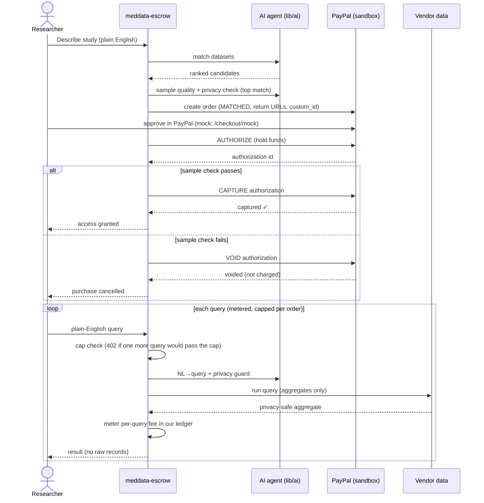

# Architecture

## Overview

meddata-escrow is a single Next.js (App Router) application. The UI (researcher
and vendor workspaces) and the backend (Next.js API routes) live in one
TypeScript codebase. AI logic sits in `lib/ai`, the PayPal integration in
`lib/paypal`, and persistence in `lib/db` (SQLite via Node's built-in
`node:sqlite`; SQL kept portable).

## Components

| Layer         | Location                                                                                                  | Responsibility                                                                        |
| ------------- | --------------------------------------------------------------------------------------------------------- | ------------------------------------------------------------------------------------- |
| Researcher UI | `app/researcher`                                                                                          | Describe a study, browse matches, query, buy, confirm and pay out                     |
| Vendor UI     | `app/vendor`                                                                                              | Catalog and prices, order queue (deliver, release, refund), ledger, webhook simulator |
| Checkout      | `app/checkout/mock`                                                                                       | Mock-mode stand-in for PayPal's approval page (approve or cancel, then back)          |
| API           | `app/api/{match,datasets,query,orders,billing,agent,demo/reset,webhooks/paypal,openapi,health}`           | Request handlers                                                                      |
| LLM           | `lib/llm/client`                                                                                          | Claude on Bedrock (opt-in), structured outputs                                        |
| AI            | `lib/ai/{matcher,nl2query,privacy-guard,sample-check,answer-summary}`                                     | Matching, NL→plan→SQL, privacy, rewrites, summaries                                   |
| Agent         | `lib/agent/{tools,run,store,shortlist,replay}`                                                            | Guardrailed procurement tool loop, run audit, ranked shortlist, replay                |
| Escrow        | `lib/escrow/{state-machine,service,fees,receipt,auth-window,paypal-webhooks,mock-webhook-events}`         | Transitions, fee split, receipts, hold window, inbound webhooks                       |
| Query caps    | `lib/db/usage` (`queryCapStatus`), `lib/query/pricing`                                                    | Per-order spend cap (default 1000 cents, 50 to 100000) checked before each charge     |
| Catalog       | `lib/catalog/price-rules`, `lib/db/datasets`                                                              | Listing prices (whole cents, $1 to $10,000) and reads                                 |
| Demo data     | `lib/db/reset`, `lib/db/demo-story`                                                                       | Mock-mode reset; optional six sample orders built through the state machine           |
| UI helpers    | `lib/ui/{compare,bar-scale,status-filter,escrow-response,order-sync,ledger,listing-stats,vendor-actions}` | Pure helpers behind the grids, polling, ledger totals and vendor buttons              |
| Payments      | `lib/paypal/client`                                                                                       | Authorize / capture / void / payouts / verify; return URLs and `custom_id` on create  |
| Delivery      | `lib/delivery/mock-s3`                                                                                    | Mock expiring download links (`presignDelivery`), an S3 presigned URL stand-in        |
| Events        | `lib/events/outbound`                                                                                     | Signed outbound webhook per transition                                                |
| HTTP          | `proxy.ts`, `lib/http`                                                                                    | Security headers, rate limits, body caps, req ids                                     |
| Data          | `lib/db/{schema.sql,seed.ts}`, `data/catalog.json`                                                        | Schema + seed (six catalog datasets)                                                  |

## Escrow flow

The sequence shows the intended money path. Today the per-query fee is metered
in the `query_usage` table only; the PayPal per-query capture is a seam in
`app/api/billing` and is not called.

## Data flow

Raw records never leave the vendor. Queries are compiled to safe, aggregate-only
operations and results pass through the privacy guard before returning.

## API routes

- `POST /api/match`: rank datasets for a study description, or sample-check one
  dataset (`{ sampleCheck }`)
- `POST /api/orders`: create an escrow order at the dataset's listed price, with
  an optional `queryCapCents`
- `PATCH /api/orders`: advance escrow (authorize, deliver, capture, payout,
  void, dispute, cancel, resolve)
- `GET /api/orders`: list orders; `?id=` adds the hold window and a mock
  `delivery` link once data is granted, `&events=1` adds the audit timeline,
  `&receipt=1` returns the fee receipt; `?summary=1` returns vendor earnings
  (gross paid out, vendor net, platform fee)
- `GET|PATCH /api/datasets`: catalog with database prices; vendors reprice
  a listing
- `POST /api/demo/reset`: mock mode only, clears demo data and reseeds the
  catalog; `{ "seed": "story" }` also adds six sample orders
- `POST /api/query`: plain-English query → privacy-safe aggregate; requires a
  paid, delivered order, is capped per order (`402`), and meters each answer
- `GET|POST /api/billing`: per-query usage and spend for an order (`402` at the cap)
- `POST /api/agent`: run the procurement agent; `GET /api/agent?runId=`
  replays a stored run
- `POST /api/webhooks/paypal`: signature-verified, deduped PayPal events,
  matched to an order by PayPal ids or our order id
- `GET /api/openapi`: the OpenAPI 3.1 contract
- `GET /api/health`: uptime check (DB + mock/live mode)

See the README's "Trust guarantees" and "API reference" for the full contract.

## Data model

See [`../lib/db/schema.sql`](../lib/db/schema.sql): `vendors`, `datasets`,
`orders` (including `query_cap_cents`), `query_usage`, `order_events`
(append-only audit trail), `paypal_webhook_events` (webhook dedupe), plus
`agent_runs` (created by `lib/agent/store`).

## Deployment (Render)

Defined in [`../render.yaml`](../render.yaml): a Node 24 web service that migrates and seeds
a PostgreSQL app database and health-checks `/api/health`. It runs in
`PAYPAL_MODE=mock` until PayPal sandbox secrets are added. Secrets are set in the
Render dashboard, never committed. Provider sources use encrypted PostgreSQL
connections and aggregate-only execution; see [live database setup](live-databases.md).

Planned, not used: DynamoDB, AWS Lambda and API Gateway. No code calls them
today. Amazon S3 is planned for delivery, and `lib/delivery/mock-s3` stands in
for it. The only AWS service in the code path is Bedrock, which is opt-in.
