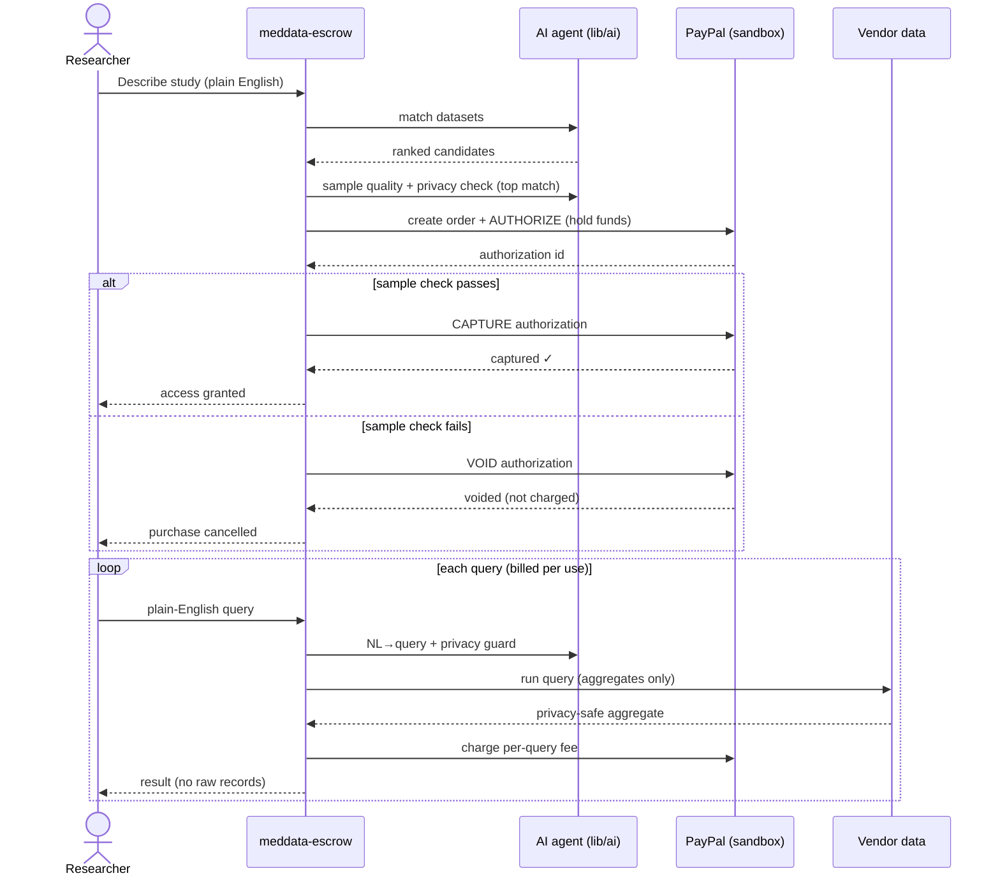

# Architecture

## Overview

meddata-escrow is a single Next.js (App Router) application. The UI (researcher
and vendor workspaces) and the backend (Next.js API routes) live in one
TypeScript codebase. AI logic sits in `lib/ai`, the PayPal integration in
`lib/paypal`, and persistence in `lib/db` (SQLite via Node's built-in `node:sqlite`; SQL kept
portable).

## Components

| Layer         | Location                                                                                          | Responsibility                                                         |
| ------------- | ------------------------------------------------------------------------------------------------- | ---------------------------------------------------------------------- |
| Researcher UI | `app/researcher`                                                                                  | Describe a study, browse matches, query, purchase                      |
| Vendor UI     | `app/vendor`                                                                                      | List datasets, manage catalog, review orders                           |
| API           | `app/api/{match,datasets,query,orders,billing,agent,demo/reset,webhooks/paypal,openapi,health}`   | Request handlers                                                       |
| LLM           | `lib/llm/client`                                                                                  | Claude on Bedrock (opt-in), structured outputs                         |
| AI            | `lib/ai/{matcher,nl2query,privacy-guard,sample-check,answer-summary}`                             | Matching, NL→plan→SQL, privacy, rewrites, summaries                    |
| Agent         | `lib/agent/{tools,run,store,shortlist,replay}`                                                    | Guardrailed procurement tool loop, run audit, ranked shortlist, replay |
| Escrow        | `lib/escrow/{state-machine,service,fees,receipt,auth-window,paypal-webhooks,mock-webhook-events}` | Transitions, fee split, receipts, hold window, inbound webhooks        |
| Catalog       | `lib/catalog/price-rules`, `lib/db/datasets`                                                      | Listing prices (whole cents, $1 to $10,000) and reads                  |
| UI helpers    | `lib/ui/{compare,bar-scale,status-filter,escrow-response}`                                        | Pure helpers behind the grids and escrow messages                      |
| Payments      | `lib/paypal/client`                                                                               | Authorize / capture / void / payouts / verify                          |
| Events        | `lib/events/outbound`                                                                             | Signed outbound webhook per transition                                 |
| HTTP          | `proxy.ts`, `lib/http`                                                                            | Security headers, rate limits, body caps, req ids                      |
| Data          | `lib/db/{schema.sql,seed.ts}`, `data/catalog.json`                                                | Schema + seed                                                          |

## Escrow flow

## Data flow

Raw records never leave the vendor. Queries are compiled to safe, aggregate-only
operations and results pass through the privacy guard before returning.

## API routes

- `POST /api/match` — rank datasets for a study description
- `POST /api/orders` — create an escrow order at the dataset's listed price
- `PATCH /api/orders` — advance escrow (authorize, deliver, capture, payout,
  void, dispute, cancel, resolve)
- `GET /api/orders`: list orders; `?id=` adds the hold window, `&events=1`
  adds the audit timeline, `&receipt=1` returns the fee receipt; `?summary=1`
  returns vendor earnings
- `GET|PATCH /api/datasets`: catalog with database prices; vendors reprice
  a listing
- `POST /api/demo/reset`: mock mode only, clears demo data and reseeds the
  catalog
- `POST /api/query` — plain-English query → privacy-safe aggregate; requires a
  paid, delivered order and meters each answer
- `GET|POST /api/billing` — per-query usage and spend for an order
- `POST /api/agent` — run the procurement agent; `GET /api/agent?runId=`
  replays a stored run
- `POST /api/webhooks/paypal` — signature-verified, deduped PayPal events
- `GET /api/openapi` — the OpenAPI 3.1 contract
- `GET /api/health` — uptime check (DB + mock/live mode)

See the README's "Trust guarantees" and "API reference" for the full contract.

## Data model

See [`../lib/db/schema.sql`](../lib/db/schema.sql): `vendors`, `datasets`,
`orders`, `query_usage`, `order_events` (append-only audit trail),
`paypal_webhook_events` (webhook dedupe), plus `agent_runs` (created by
`lib/agent/store`).

## Deployment (Render)

Defined in [`../render.yaml`](../render.yaml): a Node 24 web service that seeds
a SQLite demo database at boot and health-checks `/api/health`. It runs in
`PAYPAL_MODE=mock` until PayPal sandbox secrets are added. Secrets are set in the
Render dashboard, never committed.
